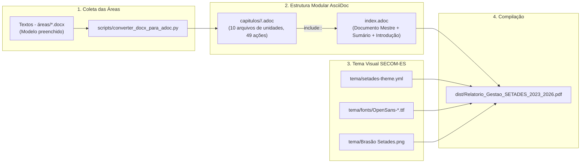

# Plano de Implementação — Relatório de Gestão SETADES (2023–2026) em AsciiDoc

## Objetivo e Contexto

Estruturar um projeto editorial automatizado em **AsciiDoc** (`Asciidoctor PDF`) para o **Relatório de Gestão da SETADES (2023–2026)**, capaz de:
1. Concatenar de forma modular os relatos de **4 Subsecretarias**, **10 Gerências/Unidades** e **49 Ações/Projetos/Processos** mapeados no documento [Lista de Ações por Subsecretaria, Gerência e Responsáveis.docx](file:///C:/Users/2970805/Documents/RelatorioGestao_2023a2026/Lista%20de%20A%C3%A7%C3%B5es%20por%20Subsecretaria,%20Ger%C3%AAncia%20e%20Respons%C3%A1veis.docx).
2. Seguir rigorosamente a ficha padronizada definida em [Modelo do texto.docx](file:///C:/Users/2970805/Documents/RelatorioGestao_2023a2026/Modelo%20do%20texto.docx) (Tabela de Identificação da Unidade + Ficha de 1 página por ação contendo *1. Descrição resumida*, *2. Entregas realizadas no mandato (2023 a 2026)* e *3. Desafios para a continuidade da ação*).
3. Aplicar a identidade visual oficial do Governo do Estado do Espírito Santo definida em [Identidade Visual do Governo do Estado_SECOM_ES.pdf](file:///C:/Users/2970805/Documents/RelatorioGestao_2023a2026/tema/Identidade%20Visual%20do%20Governo%20do%20Estado_SECOM_ES.pdf) e o brasão oficial [Brasão Setades.png](file:///C:/Users/2970805/Documents/RelatorioGestao_2023a2026/tema/Bras%C3%A3o%20Setades.png).
4. Permitir tanto a edição direta nos arquivos `.adoc` pré-estruturados quanto a importação automatizada de arquivos `.docx` enviados pelas áreas na pasta `Textos - áreas/`.

---

## Revisão e Requisitos de Ambiente

> [!IMPORTANT]
> **Instalação do Toolchain (Ruby + Asciidoctor PDF + Fontes Open Sans)**
> A verificação do sistema indicou que `python` e `node` estão instalados, mas `ruby` e `asciidoctor-pdf` ainda não estão presentes na máquina, e a família tipográfica **Open Sans** não está na pasta de fontes do Windows.
> O plano inclui:
> - Instalação automatizada do **Ruby** (via `winget install RubyInstallerTeam.RubyWithDevKit.3.2` ou pacote portátil) e da gem `asciidoctor-pdf`.
> - Download dos arquivos `.ttf` oficiais da família **Open Sans** (`Light`, `Regular`, `SemiBold`, `Bold`, `ExtraBold` e respectivos *Italics*) diretamente para `tema/fonts/`, garantindo que o PDF incorpore as fontes corretas em qualquer computador.

---

## Arquitetura do Projeto e Fluxo de Trabalho



### Estrutura de Diretórios Proposta

```text
RelatorioGestao_2023a2026/
├── index.adoc                                  # Documento mestre que concatena todo o relatório
├── compilar.ps1                                # Script PowerShell para converter .docx (opcional) e gerar o PDF
├── LEIAME.adoc                                 # Guia de uso do projeto e instruções para as áreas
├── Textos - áreas/                             # Pasta para depósito dos arquivos .docx recebidos das gerências
├── tema/
│   ├── Brasão Setades.png                      # Logomarca institucional (já existente)
│   ├── Identidade Visual do Governo...pdf      # Manual SECOM-ES (já existente)
│   ├── setades-theme.yml                       # Tema Asciidoctor PDF com paleta e tipografia SECOM-ES
│   └── fonts/                                  # Fontes Open Sans TTF para incorporação no PDF
├── scripts/
│   ├── gerar_estrutura_inicial.py              # Gera os 10 arquivos .adoc com as 49 ações mapeadas
│   └── converter_docx_para_adoc.py             # Converte fichas .docx da pasta "Textos - áreas" para .adoc
├── capitulos/
│   ├── 00-introducao.adoc                      # Apresentação institucional e síntese executiva
│   ├── SUBAAD/
│   │   ├── _index.adoc                         # Abertura da SUBAAD
│   │   ├── SUBAAD-GGCONV.adoc                  # Gerência de Gestão de Convênios (1 ação)
│   │   └── SUBAAD-GADM.adoc                    # Gerência Administrativa (1 ação)
│   ├── SUBAPI/
│   │   ├── _index.adoc                         # Abertura da SUBAPI
│   │   └── SUBAPI-GCAM.adoc                    # Gerência de Capacitação, Articulação e Mobilização (5 ações)
│   ├── SUBADES/
│   │   ├── _index.adoc                         # Abertura da SUBADES
│   │   ├── SUBADES-GPSB.adoc                   # Gerência de Proteção Social Básica (4 ações)
│   │   ├── SUBADES-GPSE.adoc                   # Gerência de Proteção Social Especial (8 ações)
│   │   ├── SUBADES-GBTR.adoc                   # Gerência de Benefícios e Transferência de Renda (7 ações)
│   │   ├── SUBADES-GSUAS.adoc                  # Gerência do Sistema Único de Assistência Social (6 ações)
│   │   ├── SUBADES-VIGILANCIA.adoc             # Vigilância Socioassistencial (8 ações)
│   │   └── SUBADES-GSAN.adoc                   # Gerência de Segurança Alimentar e Nutricional (7 ações)
│   └── SUBGEP/
│       ├── _index.adoc                         # Abertura da SUBGEP
│       └── SUBGEP-NAGI.adoc                    # Núcleo de Avaliação e Gestão da Informação (11 ações)
└── dist/
    └── Relatorio_Gestao_SETADES_2023_2026.pdf  # PDF final consolidado
```

---

## Mudanças Propostas por Componente

### 1. Identidade Visual e Tema Asciidoctor PDF (`tema/`)

Tradução fiel das diretrizes do manual [Identidade Visual do Governo do Estado_SECOM_ES.pdf](file:///C:/Users/2970805/Documents/RelatorioGestao_2023a2026/tema/Identidade%20Visual%20do%20Governo%20do%20Estado_SECOM_ES.pdf) para o arquivo de tema do Asciidoctor PDF:

| Elemento Visual | Especificação SECOM-ES (PDF p. 2–16) | Aplicação no PDF (`setades-theme.yml`) |
| :--- | :--- | :--- |
| **Azul 1 / Azul 2 / Azul 3** | `#5081A0` / `#366C88` / `#365A6D` | Títulos H1 (`#366C88`), destaques/detalhes (`#5081A0`), cabeçalho de tabelas primárias (`#365A6D`) |
| **Marsala 1 / Marsala 2 / Marsala 3** | `#B16C73` / `#9C5C6A` / `#7B4A55` | Metadados/introdução e links (`#9C5C6A`), cabeçalhos secundários e paginação (`#B16C73` / `#7B4A55`) |
| **Cinza 1 / Cinza 2 / Cinza 3** | `#CFCFCF` / `#7B7B7A` / `#585857` | Linhas separadoras e bordas de caixas/tabelas (`#CFCFCF`), subtítulos H2 e listas (`#7B7B7A`), títulos contraídos (`#585857`) |
| **Tipografia Base** | **Open Sans** (300, 400, 600, 700, 800) | Texto corpo: Regular 10pt; H1: ExtraBold 20pt (`#366C88`); H2: Bold 13pt (`#7B7B7A`); Detalhes: SemiBold 8pt (`#5081A0`); Legendas: Regular 6pt |
| **Tabelas (p. 13)** | Cabeçalho principal em Azul 3 (`#365A6D`) ou Marsala 3 (`#7B4A55`), subcabeçalho Azul 2 (`#366C88`) / Azul 1 (`#5081A0`), bordas Cinza 1 (`#CFCFCF`) | Aplicado às tabelas de Identificação da Unidade e tabelas de dados |
| **Caixas e Alerts (p. 15–16)** | Borda `1px` Cinza 1 (`#CFCFCF`), recuo `20px`; Alerts em Verde `#28A058`, Amarelo `#E2DD2D`, Azul 1 `#5081A0`, Marsala 2 `#9C5C6A` | Mapeados para blocos `sidebar`, `quote` e `admonition` (`NOTE`, `TIP`, `WARNING`, `IMPORTANT`) |

#### [NEW] `tema/setades-theme.yml`
Arquivo YAML completo de configuração do `asciidoctor-pdf` com catálogo de fontes `Open Sans`, margens A4, capa com `Brasão Setades.png`, cabeçalho e rodapé institucionais (com caixa numerada em estilo Marsala/Cinza conforme p. 24 do manual) e estilos de títulos, tabelas e separadores.

#### [NEW] `tema/fonts/OpenSans-*.ttf`
Arquivos de fonte TrueType da família Open Sans para garantir renderização idêntica em qualquer ambiente.

---

### 2. Documento Mestre e Templates Modulares (`index.adoc` e `capitulos/`)

Cada arquivo de gerência seguirá o padrão exato de [Modelo do texto.docx](file:///C:/Users/2970805/Documents/RelatorioGestao_2023a2026/Modelo%20do%20texto.docx), já preenchido com os dados de [Lista de Ações por Subsecretaria, Gerência e Responsáveis.docx](file:///C:/Users/2970805/Documents/RelatorioGestao_2023a2026/Lista%20de%20A%C3%A7%C3%B5es%20por%20Subsecretaria,%20Ger%C3%AAncia%20e%20Respons%C3%A1veis.docx).

#### [NEW] `index.adoc`
Documento raiz com atributos globais, configuração de sumário (`:toc: left`, `:toc-title: Sumário`), numeração de seções e diretivas `include::` para cada Subsecretaria e Gerência:

```asciidoc
= Relatório de Gestão SETADES (2023–2026)
Secretaria de Estado de Trabalho, Assistência e Desenvolvimento Social <setades@setades.es.gov.br>
v1.0, 2026: Consolidação Quadrienal
:doctype: book
:encoding: utf-8
:lang: pt-BR
:toc: macro
:toc-title: Sumário
:toclevels: 3
:sectnums:
:sectnumlevels: 3
:pdf-theme: tema/setades-theme.yml
:pdf-fontsdir: tema/fonts
:title-logo-image: image:tema/Brasão Setades.png[pdfwidth=4.5cm,align=center]
:imagesdir: .

include::capitulos/00-introducao.adoc[]

// 1. SUBAAD
include::capitulos/SUBAAD/_index.adoc[]
include::capitulos/SUBAAD/SUBAAD-GGCONV.adoc[leveloffset=+2]
include::capitulos/SUBAAD/SUBAAD-GADM.adoc[leveloffset=+2]

// 2. SUBAPI
include::capitulos/SUBAPI/_index.adoc[]
include::capitulos/SUBAPI/SUBAPI-GCAM.adoc[leveloffset=+2]

// 3. SUBADES
include::capitulos/SUBADES/_index.adoc[]
include::capitulos/SUBADES/SUBADES-GPSB.adoc[leveloffset=+2]
include::capitulos/SUBADES/SUBADES-GPSE.adoc[leveloffset=+2]
include::capitulos/SUBADES/SUBADES-GBTR.adoc[leveloffset=+2]
include::capitulos/SUBADES/SUBADES-GSUAS.adoc[leveloffset=+2]
include::capitulos/SUBADES/SUBADES-VIGILANCIA.adoc[leveloffset=+2]
include::capitulos/SUBADES/SUBADES-GSAN.adoc[leveloffset=+2]

// 4. SUBGEP
include::capitulos/SUBGEP/_index.adoc[]
include::capitulos/SUBGEP/SUBGEP-NAGI.adoc[leveloffset=+2]
```

#### [NEW] `capitulos/<SUBSECRETARIA>/<SUBSECRETARIA>-<GERENCIA>.adoc` (10 arquivos)
Exemplo da estrutura gerada para cada Gerência e suas respectivas ações (com quebra de página `<<<` garantindo 1 página por ação conforme regra do `Modelo do texto.docx`):

```asciidoc
= Gerência do Sistema Único de Assistência Social (GSUAS)

.Identificação da Unidade
[cols="1,3", options="header"]
|===
| Campo | Preenchimento
| *Subsecretaria* | Subsecretaria de Estado de Assistência e Desenvolvimento Social (SUBADES)
| *Gerência ou setor* | Gerência do Sistema Único de Assistência Social (GSUAS)
| *Responsável* | Quécia Cristina De Abreu (Gerente)
| *Contato* | _Preencher e-mail institucional e telefone/ramal_
|===

'''

== Cofinanciamento Estadual dos Benefícios Eventuais e Serviços Socioassistenciais Continuados

[.detalhe]#Parte 1: Relato da ação (limite de 1 página por ação)#

=== 1. Descrição resumida
// Orientações: Explique o que é a iniciativa, quem ela atende e com qual frequência acontece.
_Texto pendente de preenchimento pela área._

=== 2. Entregas realizadas no mandato (2023 a 2026)
// Orientações: Destaque os resultados alcançados, metas cumpridas, volume de atendimentos, municípios contemplados e recursos executados.
_Texto pendente de preenchimento pela área._

=== 3. Desafios para a continuidade da ação
// Orientações: Aponte as principais dificuldades orçamentárias, operacionais, de pessoal ou de tecnologia.
_Texto pendente de preenchimento pela área._

<<<
```

---

### 3. Automação: Conversor `.docx -> .adoc` e Script de Build (`scripts/` e `compilar.ps1`)

#### [NEW] `scripts/gerar_estrutura_inicial.py`
Script Python que lê [Lista de Ações por Subsecretaria, Gerência e Responsáveis.docx](file:///C:/Users/2970805/Documents/RelatorioGestao_2023a2026/Lista%20de%20A%C3%A7%C3%B5es%20por%20Subsecretaria,%20Ger%C3%AAncia%20e%20Respons%C3%A1veis.docx) e gera automaticamente os 10 arquivos `.adoc` das gerências com todas as 49 ações já cadastradas e padronizadas.

#### [NEW] `scripts/converter_docx_para_adoc.py`
Script Python que monitora a pasta `Textos - áreas/`. Quando uma gerência deposita seu arquivo Word preenchido (ex.: `Textos - áreas/SUBADES - GSUAS.docx`), o script:
1. Extrai a tabela de **Identificação da unidade** (Subsecretaria, Gerência, Responsável, Contato).
2. Identifica cada bloco de **Parte 1: Relato da ação** e extrai o título da ação e as respostas dos itens **1. Descrição resumida**, **2. Entregas realizadas no mandato (2023 a 2026)** e **3. Desafios para a continuidade da ação** (incluindo listas e tabelas internas, se houver).
3. Atualiza automaticamente o arquivo `.adoc` correspondente em `capitulos/<SUBSECRETARIA>/`, preservando a formatação AsciiDoc e as quebras de página.

#### [NEW] `compilar.ps1` e `LEIAME.adoc`
- `compilar.ps1`: Script único em PowerShell que:
  1. Opcionalmente roda `python scripts/converter_docx_para_adoc.py` para importar novos `.docx` da pasta `Textos - áreas/`.
  2. Executa `asciidoctor-pdf index.adoc -o dist/Relatorio_Gestao_SETADES_2023_2026.pdf`.
  3. Valida se o PDF foi gerado sem avisos de fontes ou referências quebradas.
- `LEIAME.adoc`: Documentação clara explicando o fluxo de trabalho para a equipe organizadora e prazos/diretrizes citados no Modelo do Texto.

---

## Plano de Verificação

### Testes Automatizados
1. **Geração da Estrutura Modular**:
   ```powershell
   python scripts/gerar_estrutura_inicial.py
   ```
   Verificar se todos os 10 arquivos de gerência e as 49 ações foram criados em `capitulos/`.
2. **Teste do Conversor `.docx -> .adoc`**:
   Executar o conversor em modo de teste sobre `Modelo do texto.docx` para garantir que a extração da tabela de identificação e das 3 subseções de cada ação funciona sem perda de conteúdo.
3. **Compilação do PDF com Tema SECOM-ES**:
   ```powershell
   .\compilar.ps1
   ```
   Confirmar que `dist/Relatorio_Gestao_SETADES_2023_2026.pdf` é gerado com código de saída `0`, sem erros de fonte ausente ou falha de YAML.

### Verificação Visual e Manual
1. Inspecionar as páginas renderizadas do PDF gerado (`dist/Relatorio_Gestao_SETADES_2023_2026.pdf`) para validar:
   - Capa institucional com o **Brasão SETADES**, paleta Azul/Marsala/Cinza e tipografia **Open Sans**.
   - Sumário navegável com as 4 Subsecretarias, 10 Gerências e 49 Ações.
   - Tabelas de identificação de unidade estilizadas segundo a página 13 do manual da SECOM-ES.
   - Paginação individual por ação (`1 página por ação`) e numeração de páginas no rodapé seguindo a página 24 do manual.
