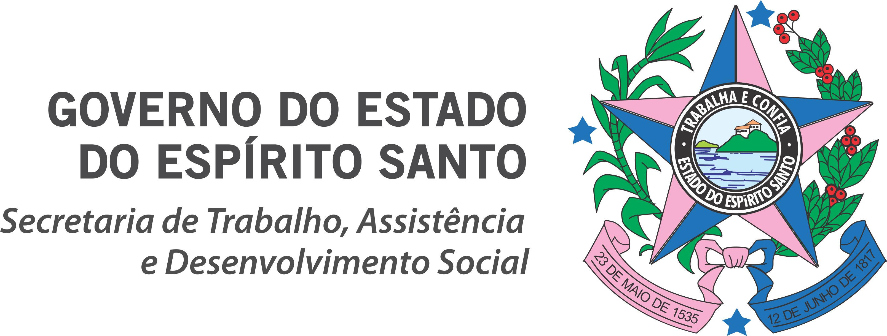

= RELATÓRIO DE GESTÃO (2023–2026)
Secretaria de Estado de Trabalho, Assistência e Desenvolvimento Social <setades@setades.es.gov.br>
v1.0, 2026: Consolidação Quadrienal das Áreas Técnicas
:doctype: book
:encoding: utf-8
:lang: pt-BR
:toc: macro
:toc-title: Sumário
:toclevels: 2
:sectnums:
:sectnumlevels: 2
:chapter-signifier: Unidade
:part-signifier: Subsecretaria
:figure-caption: Figura
:table-caption: Tabela
:pdf-theme: tema/setades-theme.yml
:pdf-fontsdir: tema/fonts
:title-logo-image: 
:imagesdir: .

toc::[]

<<<

// =============================================================================
// INTRODUÇÃO E SÍNTESE EXECUTIVA
// =============================================================================
include::capitulos/00-introducao.adoc[leveloffset=+1]

// =============================================================================
// 1. SUBSECRETARIA DE ESTADO PARA ASSUNTOS ADMINISTRATIVOS (SUBAAD)
// =============================================================================
include::capitulos/SUBAAD/_index.adoc[]

include::capitulos/SUBAAD/SUBAAD-GGCONV.adoc[leveloffset=+1]

include::capitulos/SUBAAD/SUBAAD-GADM.adoc[leveloffset=+1]

// =============================================================================
// 2. SUBSECRETARIA DE ESTADO DE ARTICULAÇÃO DE POLÍTICAS INTERSETORIAIS (SUBAPI)
// =============================================================================
include::capitulos/SUBAPI/_index.adoc[]

include::capitulos/SUBAPI/SUBAPI-GCAM.adoc[leveloffset=+1]

// =============================================================================
// 3. SUBSECRETARIA DE ESTADO DE ASSISTÊNCIA E DESENVOLVIMENTO SOCIAL (SUBADES)
// =============================================================================
include::capitulos/SUBADES/_index.adoc[]

include::capitulos/SUBADES/SUBADES-GPSB.adoc[leveloffset=+1]

include::capitulos/SUBADES/SUBADES-GPSE.adoc[leveloffset=+1]

include::capitulos/SUBADES/SUBADES-GBTR.adoc[leveloffset=+1]

include::capitulos/SUBADES/SUBADES-GSUAS.adoc[leveloffset=+1]

include::capitulos/SUBADES/SUBADES-VIGILANCIA.adoc[leveloffset=+1]

include::capitulos/SUBADES/SUBADES-GSAN.adoc[leveloffset=+1]

// =============================================================================
// 4. SUBSECRETARIA DE ESTADO DE GESTÃO DE PROGRAMAS E PROJETOS (SUBGEP)
// =============================================================================
include::capitulos/SUBGEP/_index.adoc[]

include::capitulos/SUBGEP/SUBGEP-NAGI.adoc[leveloffset=+1]
